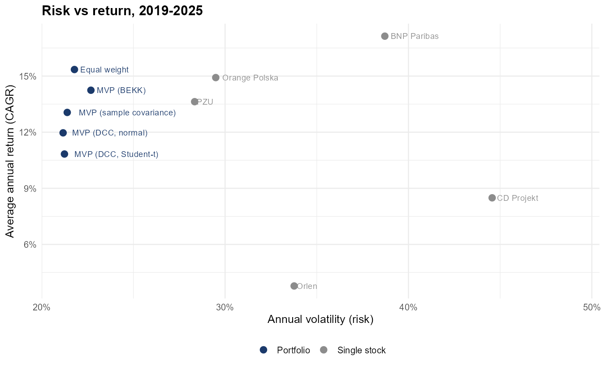
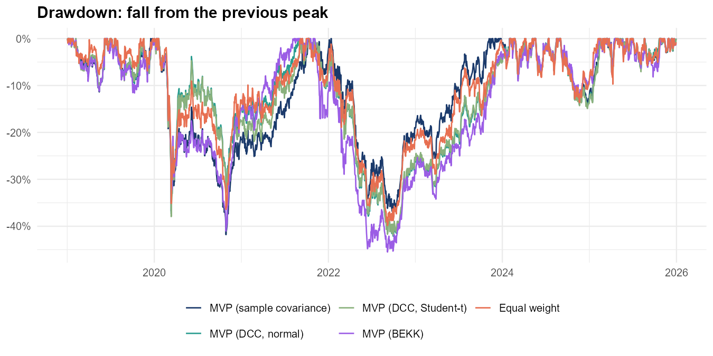
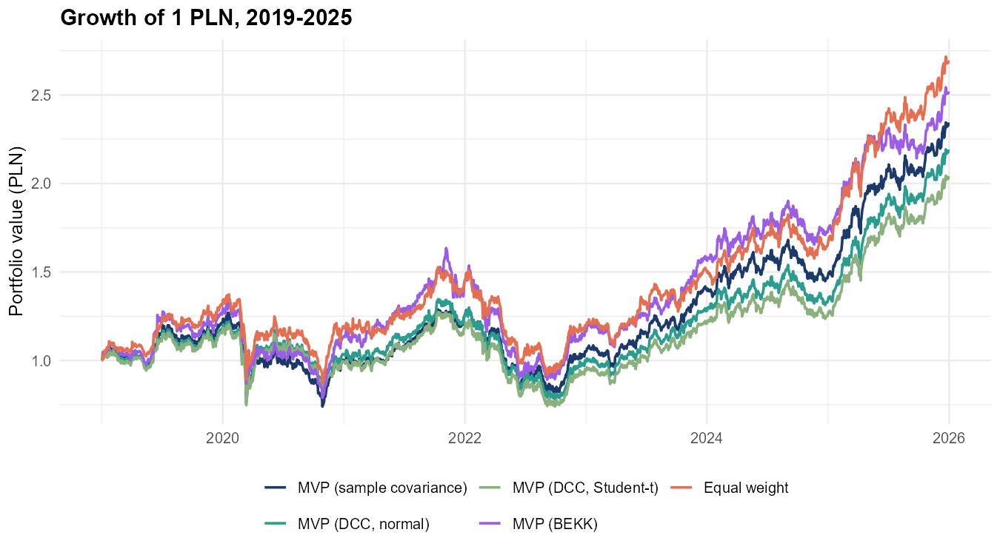
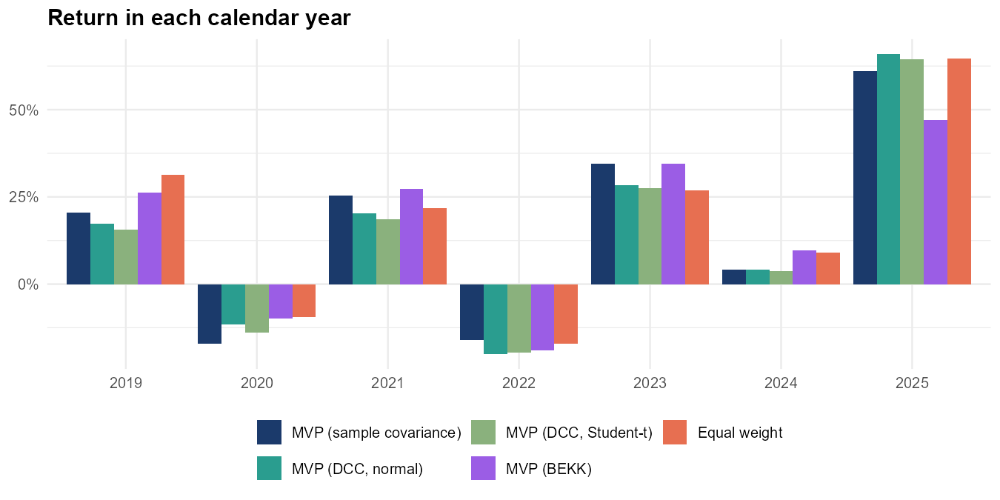
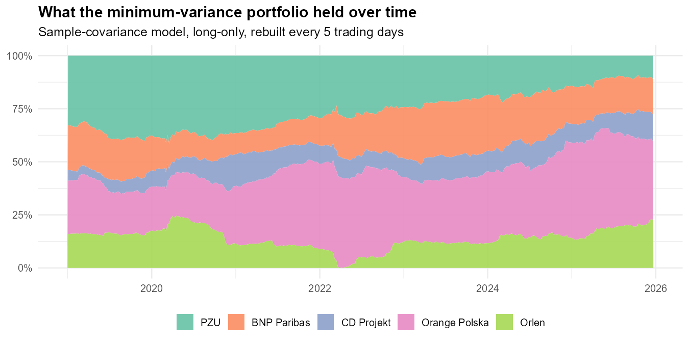

# Minimum-Variance Portfolio on the Warsaw Stock Exchange

**Tools:** R (rugarch, rmgarch, mgarchBEKK, quadprog, ggplot2, parallel)

## In short

I built five portfolios from the same five Polish stocks and tested them on 2019–2025 data, simulating decisions an investor could have made in real time. Four of the portfolios aim for the lowest possible risk, each using a different way of estimating how the stocks move together: a simple historical estimate, two versions of the DCC-GARCH model and the BEKK-GARCH model. The fifth simply puts 20% into each stock.

The question was whether the more advanced models actually reduce risk. **They did not.** The advanced models were no better than the simple estimate, and the plain equal-weight portfolio gave the best return for the risk taken.

## Data and approach

- **Stocks:** PZU, BNP Paribas Bank Polska, CD Projekt, Orange Polska and Orlen. Daily closing prices from stooq.pl, December 2016 – December 2025.
- **No look-ahead:** every 5 trading days each portfolio is rebuilt using only the previous 500 trading days (about two years) of data. It is then held, unchanged, until the next rebuild. All results below come from days the models had not seen.
- **Rules:** no short selling, always fully invested.
- **Measures:** average annual return (CAGR), volatility, maximum drawdown (the worst fall from a previous peak) and three return-to-risk ratios: Sharpe, Sortino and Calmar. Because the goal of a minimum-variance portfolio is low risk, volatility is the main yardstick.

## What I found

### 1. Diversification did most of the work



*Each dot is one strategy. All five portfolios (blue) sit at 21–23% annual volatility, while the individual stocks (grey) range from 28% to 45%. Combining the five stocks cut risk by about a third; the choice of model changed it by less than 1.5 percentage points.*

### 2. The advanced models did not lower risk

The DCC-GARCH portfolio had the lowest volatility, but only by 0.2 percentage points compared with the simple historical estimate (21.17% vs 21.39%), and it earned less. BEKK did the opposite of what it was meant to do: it had the highest volatility of all portfolios (22.68%) and the deepest fall (−45.5%). BEKK has to estimate 65 parameters from 500 days of data, and the noise in those estimates outweighs any benefit from the extra flexibility.



*How far each portfolio was below its previous peak. All of them went through two deep falls: the 2020 pandemic crash, followed by a second low in autumn 2020, and the 2022 sell-off. BEKK (purple) fell the furthest in 2022.*

### 3. The simplest portfolio won



*Value of 1 PLN invested at the start of 2019. The equal-weight portfolio ends at about 2.7 PLN, ahead of every minimum-variance version (2.0–2.5 PLN).*

The equal-weight portfolio had the best Sharpe ratio (0.70), the best Calmar ratio (0.39) and the smallest drawdown (−39.9%), with volatility only 0.4 percentage points higher than the simple minimum-variance portfolio. This matches a well-known result in finance research (DeMiguel, Garlappi and Uppal, 2009): with few assets and noisy estimates, splitting money equally is hard to beat.



*Return in each calendar year. No strategy wins every year: equal weight was best in 2019, BEKK in 2021, 2023 and 2024, but BEKK was clearly the worst in 2025. This is another sign that none of the models has a stable advantage.*

### 4. What the optimiser chose



*Share of each stock in the simple minimum-variance portfolio over time. At the start PZU was the largest holding (about a third). Over time Orange Polska, a defensive telecom stock, grew to around 40% while PZU shrank to about 10%. CD Projekt, the most volatile stock, stayed small throughout, and Orlen was briefly dropped to almost zero in early 2022.*

On average the portfolio held Orange Polska 32%, PZU 26%, BNP Paribas 18%, Orlen 14% and CD Projekt 9%.

## Full results

Out-of-sample period 2 January 2019 – 30 December 2025, 350 portfolio rebuilds.

| Strategy | CAGR | Volatility | Sharpe | Sortino | Max drawdown | Calmar | VaR 95% | ES 95% |
|---|---|---|---|---|---|---|---|---|
| MVP, sample covariance | 13.06% | 21.39% | 0.61 | 0.88 | −41.79% | 0.31 | 2.01% | 2.95% |
| MVP, DCC-GARCH (normal) | 11.97% | **21.17%** | 0.57 | 0.81 | −42.10% | 0.28 | **1.93%** | 2.96% |
| MVP, DCC-GARCH (Student-t) | 10.83% | 21.24% | 0.51 | 0.73 | −41.88% | 0.26 | 1.95% | 2.96% |
| MVP, BEKK-GARCH | 14.24% | 22.68% | 0.63 | 0.91 | −45.49% | 0.31 | 2.07% | 3.11% |
| **Equal weight** | **15.35%** | 21.79% | **0.70** | **1.03** | **−39.86%** | **0.39** | 2.02% | 2.97% |
| PZU | 13.63% | 28.34% | 0.48 | 0.70 | −51.33% | 0.27 | 2.76% | 3.94% |
| BNP Paribas | 17.13% | 38.71% | 0.44 | 0.65 | −57.89% | 0.30 | 3.65% | 5.42% |
| CD Projekt | 8.49% | 44.56% | 0.19 | 0.27 | −82.43% | 0.10 | 4.28% | 6.51% |
| Orange Polska | 14.92% | 29.49% | 0.51 | 0.77 | −39.00% | 0.38 | 2.58% | 3.82% |
| Orlen | 3.78% | 33.77% | 0.11 | 0.16 | −65.00% | 0.06 | 3.41% | 4.69% |

VaR and ES are daily: the loss exceeded on the worst 5% of days, and the average loss on those days.

The GARCH models estimated successfully almost every time. When an estimation failed, the simple historical estimate was used for that period instead: this happened in 0% of rebuilds for DCC (normal), 0.3% for DCC (Student-t) and 2.9% for BEKK, so the GARCH results really reflect the GARCH models.

## Limitations

- Transaction costs are not included, and the models trade different amounts.
- Five stocks from one market; the results may not hold for larger or different portfolios.
- The Sharpe and Sortino ratios assume a zero risk-free rate.

## Repository contents and how to run

```
├── run_analysis.R      # the full analysis, from data to charts
├── R/utils.R           # data loading, portfolio weights, backtest, performance measures
├── R/garch_models.R    # DCC and BEKK risk forecasts
├── data/               # input prices
├── results/            # all result tables (CSV)
└── figures/            # charts used above
```

```r
# R 4.1 or newer; missing packages are installed automatically.
Rscript run_analysis.R
```

